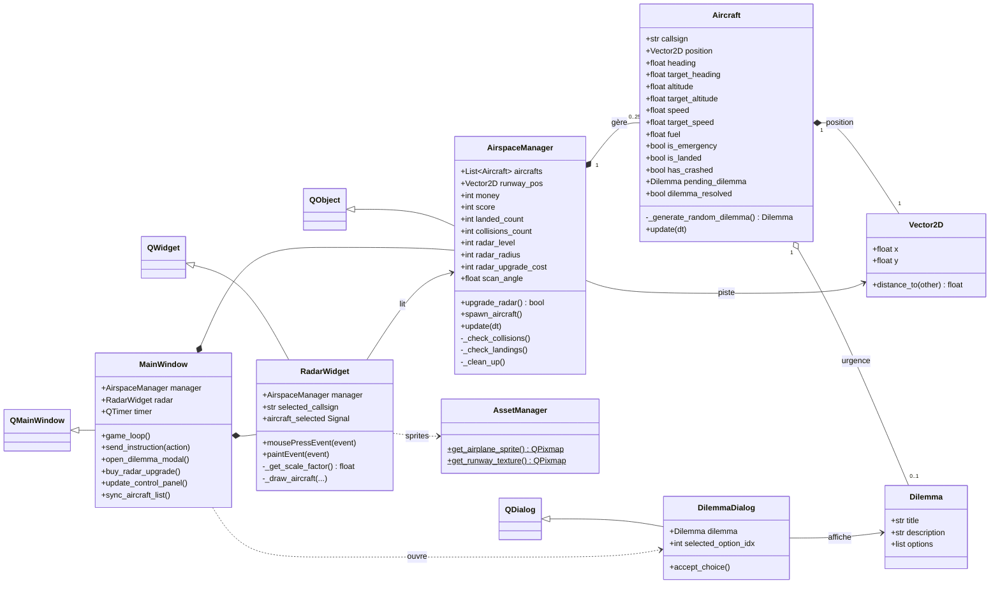
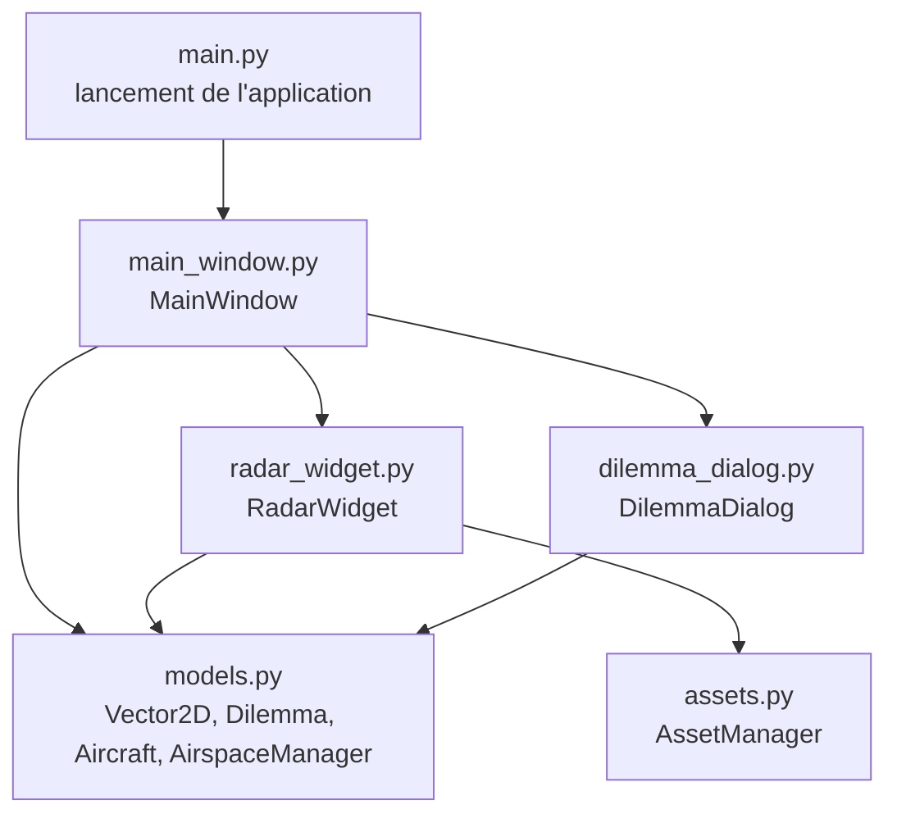

# Diagramme UML des classes

GitHub affiche ce diagramme directement (bloc Mermaid).

## Organisation en fichiers

Chaque partie de travail a son fichier. Une flèche signifie « importe » : les dépendances vont toujours du haut vers le bas.

## Répartition par fichier

| Fichier | Classes | Responsable |
| --- | --- | --- |
| assets.py | AssetManager | Personne A (interface) |
| models.py | Vector2D, Dilemma, Aircraft, AirspaceManager | Personne B (fonctionnement) |
| radar_widget.py | RadarWidget | Personne A (interface) |
| dilemma_dialog.py | DilemmaDialog | Personne A (interface) |
| main_window.py | MainWindow | Personne A (interface) |
| main.py | point d'entrée (aucune classe) | commun |
